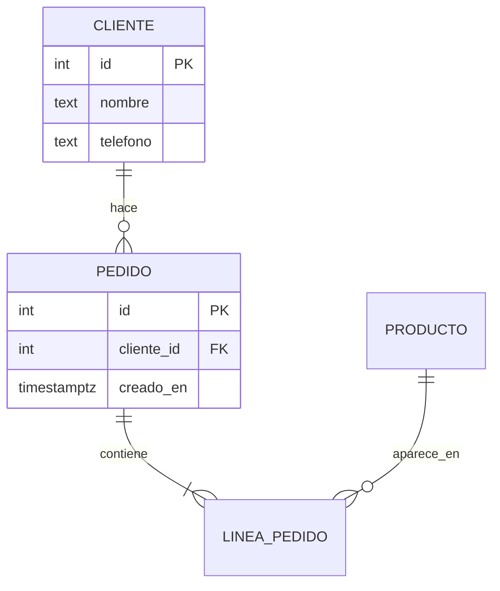

# PRD · <Fix my street>

> Documento de requisitos del producto (Product Requirements Document).
> Complétalo en el Sprint 0 (historia H0.3) y pide la aprobación del profesor en un Issue.
> Cada requisito funcional (RF) se convierte en un Issue con la plantilla "Historia de usuario".

| Campo | Valor |
| --- | --- |
| Alumno |Andrés Malavé|
| Proyecto n.º |31|
| Sitio de referencia |FixMyStreet|
| Compañero revisor | |
| URL desplegada | (se completa en el Sprint 5) |

## 1. Problema
Los reportes de problemas en la vía pública y servicios urbanos suelen dispersarse en canales informales o perderse sin seguimiento claro, lo que dificulta priorizar incidencias y comunicar avances a los vecinos.

## 2. Usuarios
- **Ciudadano:** Persona que reporta una incidencia urbana y consulta su avance.
- **Gestor / Operador:** Persona que valida, clasifica y actualiza el estado de los reportes.

## 3. Alcance (MVP / Sprint 0–1)
- **Incluye:** Registro y listado de incidencias urbanas, filtrado por estado/categoría, detalle de reporte y actualización de estado.
- **No incluye (por ahora):** Integración con sistemas municipales externos, notificaciones SMS masivas o facturación.

## 4. Requisitos funcionales y no funcionales
- **RF1:** Crear un reporte con título, descripción, categoría y ubicación/referencia.
- **RF2:** Listar y filtrar reportes existentes.
- **RF3:** Actualizar el estado de un reporte (por ejemplo: `pendiente`, `en_progreso`, `resuelto`).
- **RNF1:** Interfaz clara y usable en escritorio y móvil; respuestas rápidas de la API y base de datos en entorno local.

## 5. Estructura prevista en `src/`
- `src/app/` — Configuración de la aplicación y servidor.
- `src/routes/` o `src/api/` — Endpoints y manejo de peticiones HTTP.
- `src/services/` o `src/domain/` — Lógica de negocio de reportes.
- `src/db/` o `src/repositories/` — Acceso a datos, migraciones y seeds.
- `src/ui/` o `src/components/` — Vistas y componentes de interfaz.

-

## 6. Requisitos funcionales

| ID | Requisito | Prioridad (alta, media, baja) |
| --- | --- | --- |
| RF-01 | | |
| RF-02 | | |

## 7. Requisitos no funcionales

- Responsive, móvil primero (375 px y 1280 px).
- Lighthouse ≥ 90 en Accesibilidad y Buenas prácticas.
- 0 errores en la consola del navegador.
- Funciona con 10.000 registros sin congelarse.

## 8. Modelo de datos

Diagrama entidad-relación y tablas PostgreSQL con tipos, claves y restricciones.
GitHub dibuja diagramas Mermaid; edita este ejemplo:

## 9. Reto técnico distintivo

El que te tocó en el catálogo y cómo piensas resolverlo.

## 10. Riesgos y preguntas abiertas

-
